# quant-models-lab

Four classic quantitative finance models, implemented from scratch in Python, unit-tested, and run on real market data or seeded simulations.

[](https://github.com/JayZhangDev/quant-models-lab/actions/workflows/ci.yml)

[](LICENSE)

## What's inside

| # | Model | Question it answers | Key result from my runs |
|---|---|---|---|
| 1 | [Marchenko-Pastur](#1-marchenko-pastur-cleaning-a-correlation-matrix) (random matrix theory) | How much of a stock correlation matrix is real, and how much is noise? | Cleaning the matrix cut the out-of-sample volatility of a 200-stock minimum-variance portfolio from **19.7% to 9.9%** |
| 2 | [Avellaneda-Stoikov](#2-avellaneda-stoikov-market-making) (market making) | Where should a market maker place their bid and ask? | Inventory-aware quotes halved the spread of profits (std **6.5 vs 12.9**) for a 5% lower mean, matching the paper |
| 3 | [Kalman filter](#3-kalman-filter-pairs-trading) (pairs trading) | How do you hedge two related stocks when the hedge ratio keeps moving? | Kalman beat a rolling regression on all 3 pairs out of sample, but the best Sharpe was only **0.08** after costs: no tradable edge |
| 4 | [Almgren-Chriss](#4-almgren-chriss-optimal-execution) (optimal execution) | How fast should you sell a large block of shares? | Selling 1M shares evenly costs **\$0.69M ± \$1.21M**; the optimal schedule trades cost for risk, and a 10,000-path simulation matches the formulas within 0.4 standard errors |

Every number above is produced by the scripts in [`experiments/`](experiments) and saved in [`results/`](results). Each model also has a plain-English walkthrough in [`docs/`](docs).

## Reproduce it

```bash
make setup && make run-all
```

`make setup` creates a virtual environment with [uv](https://docs.astral.sh/uv/) and installs the package. `make run-all` runs the four experiments (about a minute; the first run downloads prices from Yahoo Finance and caches them in `data/cache/`). `make test` runs the unit tests and `make lint` runs ruff.

No `make` (for example on Windows)? Run the same commands directly:

```bash
uv sync
uv run pytest
uv run python experiments/run_rmt.py
uv run python experiments/run_avellaneda_stoikov.py
uv run python experiments/run_kalman_pairs.py
uv run python experiments/run_almgren_chriss.py
```

Without uv: `python -m venv .venv`, activate it, then `pip install -e . pytest ruff`.

Simulations use fixed seeds, so experiments 2 and 4 reproduce exactly. Experiments 1 and 3 use fixed date ranges, but Yahoo occasionally revises adjusted prices, so their numbers can move in the last decimal.

---

## 1. Marchenko-Pastur: cleaning a correlation matrix

**Intuition.** With 300 stocks there are 44,850 pairwise correlations to estimate, but four years of daily data gives only about 1,000 observations per stock. Most of what you measure is therefore noise. Random matrix theory says exactly what pure noise looks like: its eigenvalues fall inside a known band. Anything above the band is real structure; everything inside it can be flattened.

With $N$ stocks, $T$ days and $q = N/T$, the noise band and the density of noise eigenvalues are

$$\lambda_{\pm} = \sigma^2 \left(1 \pm \sqrt{q}\right)^2$$

$$\rho(\lambda) = \frac{\sqrt{(\lambda_+ - \lambda)(\lambda - \lambda_-)}}{2 \pi q \sigma^2 \lambda}, \qquad \lambda_- \le \lambda \le \lambda_+$$

**What I found (300 S&P 500 stocks, Nov 2022 to Oct 2026, q = 0.30).**

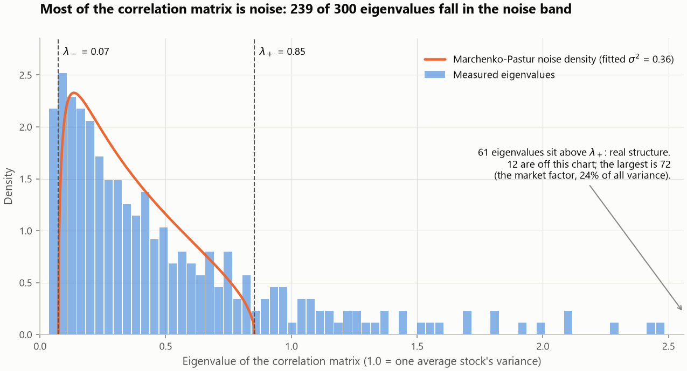

- 239 of 300 eigenvalues sit inside the fitted noise band $[0.07, 0.85]$ ($\sigma^2 = 0.36$).
- The largest eigenvalue is 71.8, which is 24% of all variance. Its eigenvector has the same sign for all 300 stocks: it is "the market" ([figure](results/rmt_market_eigenvector.png)).
- The fit is only approximate. Real eigenvalues have a fatter right tail than the theory (sectors and industries), and the fitted $\sigma^2$ moves between about 0.27 and 0.37 depending on the histogram bin count.

**Does cleaning help a real portfolio?** Rolling test: estimate the covariance on one year, hold a minimum-variance portfolio for one month, roll forward (35 months, Nov 2023 to Oct 2026). I used a random 200-stock subset so that $q = 200/252 = 0.79 < 1$.

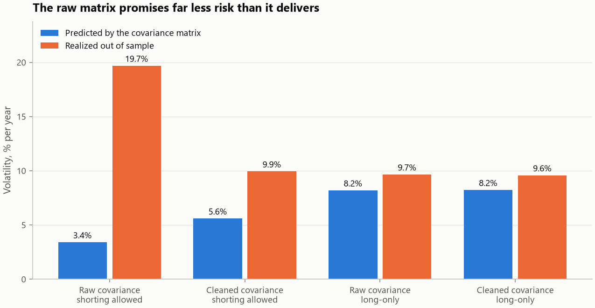

| Covariance | Constraint | Predicted vol | Realized vol | Realized / predicted | Monthly turnover |
|---|---|---|---|---|---|
| Raw | shorting allowed | 3.4% | 19.7% | 5.8x | 445% |
| Cleaned | shorting allowed | 5.6% | 9.9% | 1.8x | 72% |
| Raw | long-only | 8.2% | 9.7% | 1.2x | 21% |
| Cleaned | long-only | 8.2% | 9.6% | 1.2x | 20% |
| Equal weight | benchmark | n/a | 13.1% | n/a | 0% |

The raw matrix promised 3.4% volatility and delivered 19.7%, worse than simply holding every stock equally. The optimizer had found "riskless" combinations that only existed in the noise. Cleaning halved the realized risk and cut trading by a factor of six. The result does not depend on how the noise threshold is chosen: three different rules all give 9.9% to 10.2% ([table](results/rmt_threshold_robustness.md)).

The surprise was the long-only rows: once short selling is forbidden, cleaning barely matters. The constraint already stops the optimizer from building the extreme long-short bets that noise invites.

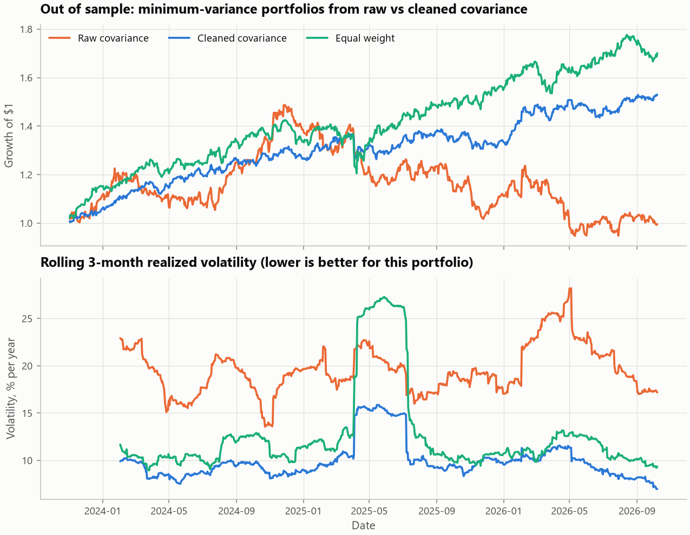

**Limitations / what I'd do next**

- The cleaned matrix still under-predicts risk by 1.8x. Volatility also changes over time, which this method ignores.
- Eigenvalue clipping throws away real pair-level structure: HD-LOW correlation drops from 0.88 to 0.70 after cleaning ([heatmap](results/rmt_correlation_heatmap.png)). Next: Ledoit-Wolf shrinkage and the rotationally invariant estimator, compared on the same test.
- The universe is today's index members, so it has survivorship bias (companies that failed are missing).
- Three years of out-of-sample data is one market regime. Returns and Sharpe ratios in the full table are not the point; the volatility comparison is.

## 2. Avellaneda-Stoikov market making

**Intuition.** A market maker earns the bid-ask spread but ends up holding inventory that can lose value. The model says: quote around a *reservation price* that leans against your inventory. If you are long, shift both quotes down so that you are more likely to sell and less likely to buy more.

$$r(s, t) = s - q \gamma \sigma^2 (T - t)$$

$$\delta^a + \delta^b = \gamma \sigma^2 (T - t) + \frac{2}{\gamma} \ln\left(1 + \frac{\gamma}{k}\right)$$

$$\lambda(\delta) = A e^{-k \delta}$$

Here $s$ is the mid-price, $q$ the inventory, $\gamma$ the risk aversion, $\sigma$ the volatility, and $\lambda(\delta)$ the rate at which a quote $\delta$ away from the mid gets filled.

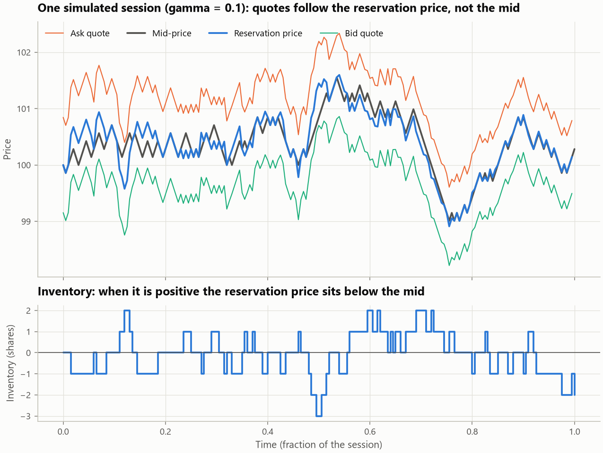

**What I found.** 1,000 simulated sessions per strategy with the paper's parameters ($s_0 = 100$, $T = 1$, $\sigma = 2$, $dt = 0.005$, $k = 1.5$, $A = 140$). The symmetric strategy quotes the same spread but centers it on the mid-price.

| $\gamma$ | Strategy | Avg spread | Mean profit | Std profit | Mean final $q$ | Std final $q$ |
|---|---|---|---|---|---|---|
| 0.01 | Inventory | 1.35 | 68.83 | 8.99 | -0.07 | 5.44 |
| 0.01 | Symmetric | 1.35 | 69.54 | 13.27 | -0.15 | 8.71 |
| 0.10 | Inventory | 1.49 | 65.10 | 6.54 | -0.10 | 2.99 |
| 0.10 | Symmetric | 1.49 | 68.75 | 12.87 | -0.13 | 8.50 |
| 0.50 | Inventory | 2.16 | 48.66 | 6.03 | -0.12 | 1.92 |
| 0.50 | Symmetric | 2.16 | 59.01 | 11.24 | -0.27 | 7.14 |

**Do my results reproduce the paper's claim? Yes.** The paper's claim is that the inventory strategy has a lower variance of profit and of final inventory, in exchange for a somewhat lower mean profit. That holds at all three risk aversions. I did not copy the paper's table into the tests, so I only claim the qualitative pattern, not matching decimals; one number I could check by hand is the average spread at $\gamma = 0.1$, 1.49, which a test confirms against the formula. The cost of the insurance grows with $\gamma$: 1% of mean profit at $\gamma = 0.01$, 5% at 0.1, and 18% at 0.5.

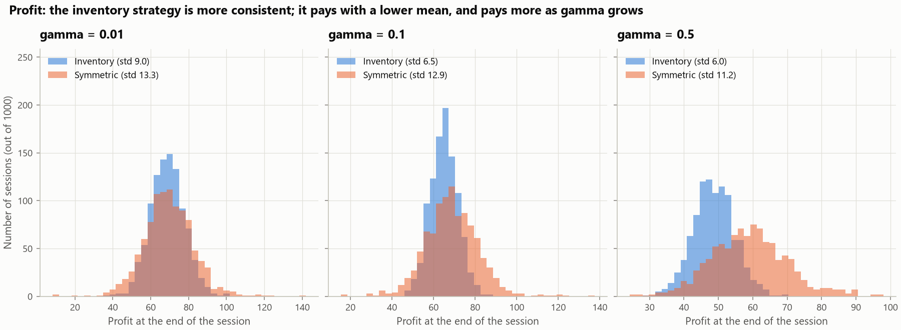

**Limitations / what I'd do next**

- The price is a driftless random walk and order arrivals are a simple exponential function of distance. Real order flow is clustered and often informed: the trader hitting your quote may know something you do not (adverse selection).
- Fills are one share at a time with no queue position, no tick size and no fees.
- Next: calibrate $A$ and $k$ from real limit order book data and add an inventory limit.

## 3. Kalman filter pairs trading

**Intuition.** Two related assets (Coca-Cola and Pepsi) tend to move together, so their gap should come back when it gets unusually wide. To measure the gap you need a hedge ratio $\beta$, and it drifts. The Kalman filter treats $\beta$ and $\alpha$ as hidden values that follow a random walk and updates them every day.

$$y_t = \beta_t x_t + \alpha_t + \varepsilon_t, \qquad \varepsilon_t \sim N(0, R)$$

$$\theta_t = \theta_{t-1} + w_t, \qquad \theta_t = (\beta_t, \alpha_t), \qquad w_t \sim N\left(0, \tfrac{\delta}{1 - \delta} I\right)$$

$$K_t = \frac{P_{t|t-1} h_t}{h_t^\top P_{t|t-1} h_t + R}, \qquad \hat{\theta}_t = \hat{\theta}_{t|t-1} + K_t e_t, \qquad h_t = (x_t, 1)$$

$$z_t = \frac{e_t}{\sqrt{h_t^\top P_{t|t-1} h_t + R}}, \qquad e_t = y_t - h_t^\top \hat{\theta}_{t|t-1}$$

The trading signal $z_t$ is the prediction error divided by the size the filter expected. Enter when $|z| > 2$, exit when $|z| < 0.5$.

**Setup.** Daily log prices, Jan 2014 to Oct 2026. The first 60% (to Sep 2021) is used to fit $R$ by maximum likelihood and to choose $\delta$ by Sharpe ratio; the last 40% is the test. Costs are 5 bps of every dollar traded. The baseline is a 60-day rolling regression traded with the same rule.

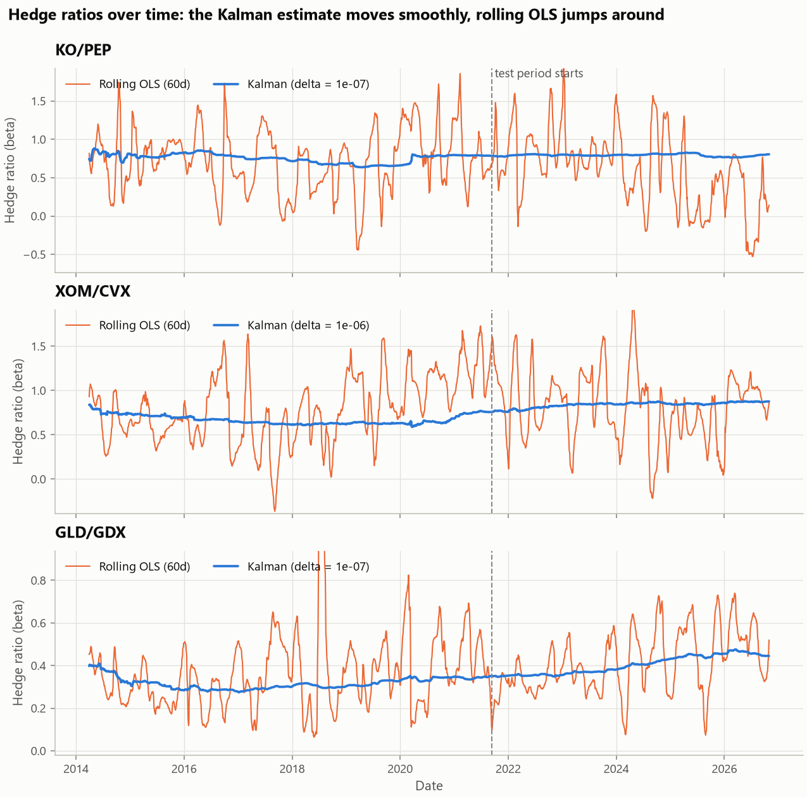

**What I found (out of sample, Sep 2021 to Oct 2026, after costs).**

| Pair | Method | Sharpe | Annual return | Max drawdown | Trades |
|---|---|---|---|---|---|
| KO / PEP | Kalman ($\delta$ = 1e-7) | -0.21 | -1.0% | -14.1% | 37 |
| KO / PEP | Rolling OLS (60d) | -0.54 | -4.0% | -28.8% | 33 |
| XOM / CVX | Kalman ($\delta$ = 1e-6) | -0.19 | -0.7% | -8.5% | 53 |
| XOM / CVX | Rolling OLS (60d) | -0.25 | -2.0% | -24.2% | 38 |
| GLD / GDX | Kalman ($\delta$ = 1e-7) | 0.08 | 0.3% | -10.6% | 39 |
| GLD / GDX | Rolling OLS (60d) | -0.32 | -2.2% | -25.9% | 33 |

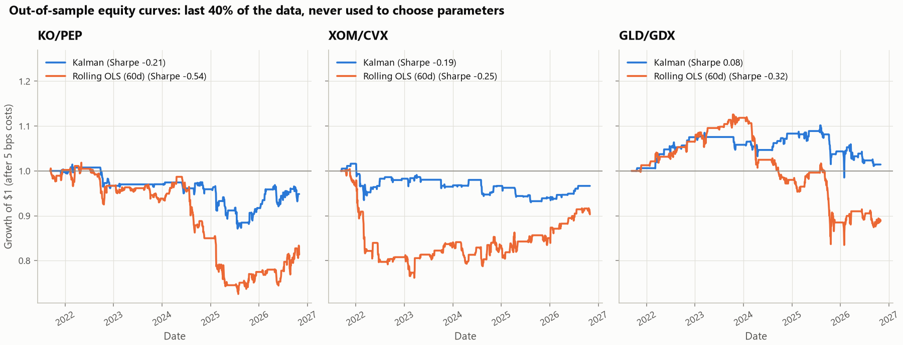

The honest summary: **the Kalman hedge is better than the rolling regression on every pair, with drawdowns about half to a third as large, but neither makes money.** Two reasons show up in the data:

- **The pairs were not reliably cointegrated.** Engle-Granger p-values on the training window: KO/PEP 0.003, XOM/CVX 0.79, GLD/GDX 0.28. Only KO/PEP passes, and its p-value in the test window is 0.72: the relationship broke down after I "discovered" it.
- **Costs eat the small edge.** These are the most famous pairs in every textbook, traded once a day.

Choosing $\delta$ shows the tradeoff directly. Tiny $\delta$ makes $\beta$ almost fixed (like one long regression) and trades rarely; large $\delta$ lets $\beta$ and $\alpha$ absorb every move, so no signal is left and the strategy stops trading. A $\delta$ only counts if it traded at least 20 times in training, so the choice is not based on a lucky handful of trades.

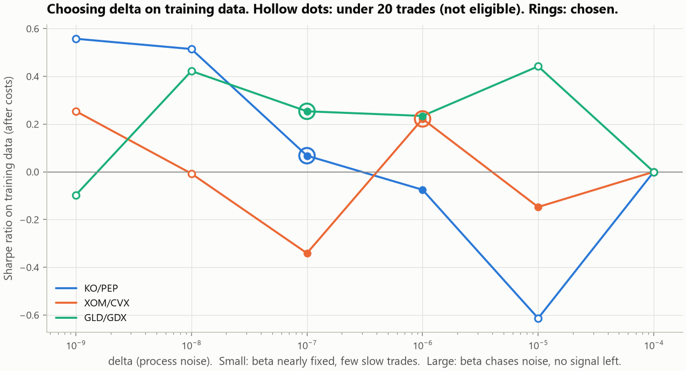

**Limitations / what I'd do next**

- Three hand-picked pairs is a tiny sample. A real study would screen hundreds of pairs for cointegration on training data and correct for testing many of them.
- Training Sharpe ratios (0.07 to 0.25) are too weak and noisy to choose $\delta$ reliably; maximum likelihood for $\delta$ as well as $R$ would be more principled.
- The hedge ratio is frozen during each trade and the position is only dollar-neutral when $\beta = 1$. No borrow costs for the short leg.
- Daily closes only. The effect may exist at higher frequency, where costs matter even more.

## 4. Almgren-Chriss optimal execution

**Intuition.** Selling a million shares at once crushes the price. Selling slowly avoids that, but leaves you exposed to the price drifting while you wait. The model finds the schedule that best balances the two for a trader with risk aversion $\lambda$.

$$\min_x \; E[C] + \lambda \, \mathrm{Var}[C]$$

$$x(t) = X \, \frac{\sinh\left(\kappa (T - t)\right)}{\sinh(\kappa T)}, \qquad \kappa = \sqrt{\frac{\lambda \sigma^2}{\eta}}$$

$x(t)$ is the number of shares still held, $\eta$ the temporary impact and $\sigma$ the volatility. The code uses the exact discrete-time version, derived step by step in [`almgren_chriss.py`](src/qml/execution/almgren_chriss.py), and a test confirms it converges to the formula above.

**Setup (the paper's example).** Sell 1,000,000 shares of a \$50 stock in 5 days, in 65 half-hour buckets. Volatility 30% a year (\$0.95 per day), daily volume 5M shares, bid-ask spread \$0.125. Trading 1% of daily volume costs one spread temporarily ($\eta = 2.5 \times 10^{-6}$); selling 10% of daily volume moves the price one spread permanently ($\gamma = 2.5 \times 10^{-7}$).

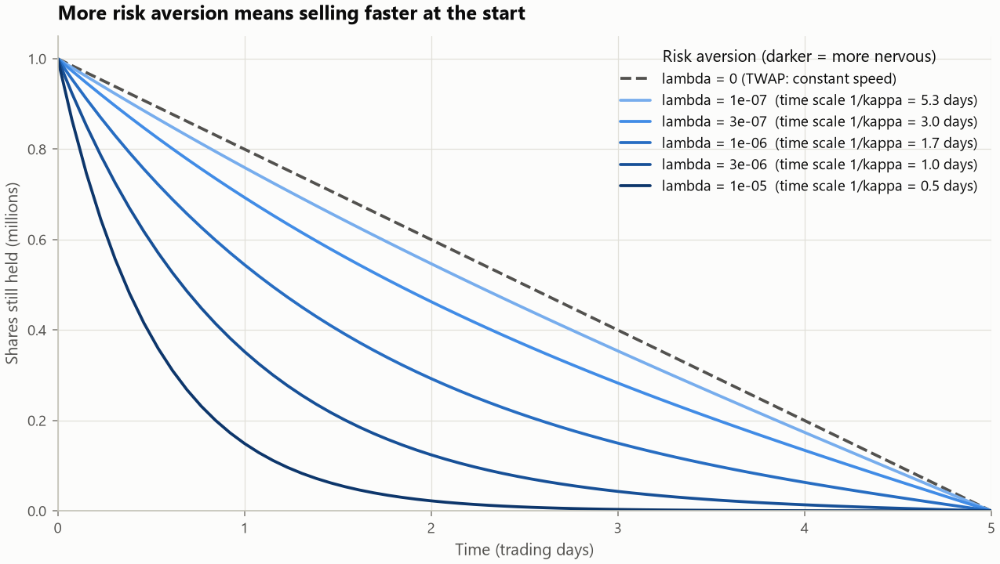

**What I found.**

| Schedule | $\lambda$ | Expected cost | Std of cost | Cost in bps of \$50M |
|---|---|---|---|---|
| TWAP (constant speed) | 0 | \$0.69M | \$1.21M | 137 |
| Moderate | 1e-6 | \$0.96M | \$0.83M | 193 |
| Nervous trader | 1e-5 | \$2.55M | \$0.45M | 510 |

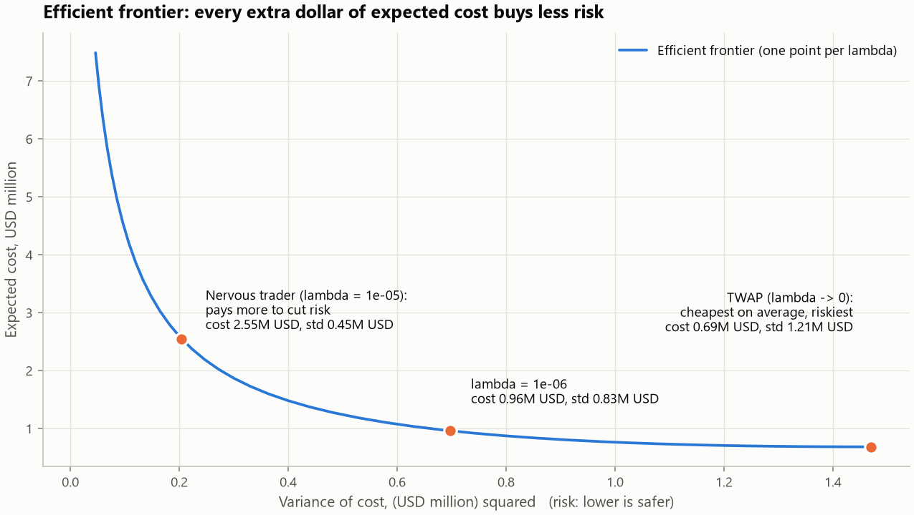

- **The frontier is steep at the safe end.** Going from TWAP to the moderate schedule costs \$0.28M more on average and removes \$0.38M of standard deviation. Going on to the nervous schedule costs another \$1.59M to remove the same \$0.38M.
- **Monte Carlo agrees with the formulas.** On 10,000 simulated price paths the mean cost is within 0.4 standard errors of the closed form for all three schedules, and the standard deviation within 1% ([figure](results/ac_monte_carlo_check.png)).
- **Square-root impact changes the shape.** Real impact grows more like the square root of trading speed than linearly. With no formula available I solved that case numerically. At the same $\lambda$ the square-root schedule opens with a trade more than twice as large (100,000 vs 45,000 shares) and has sold 68% after one day instead of 46%. Under a square-root law, doubling your speed costs less than double per share, so trading fast early to shed risk is cheaper.

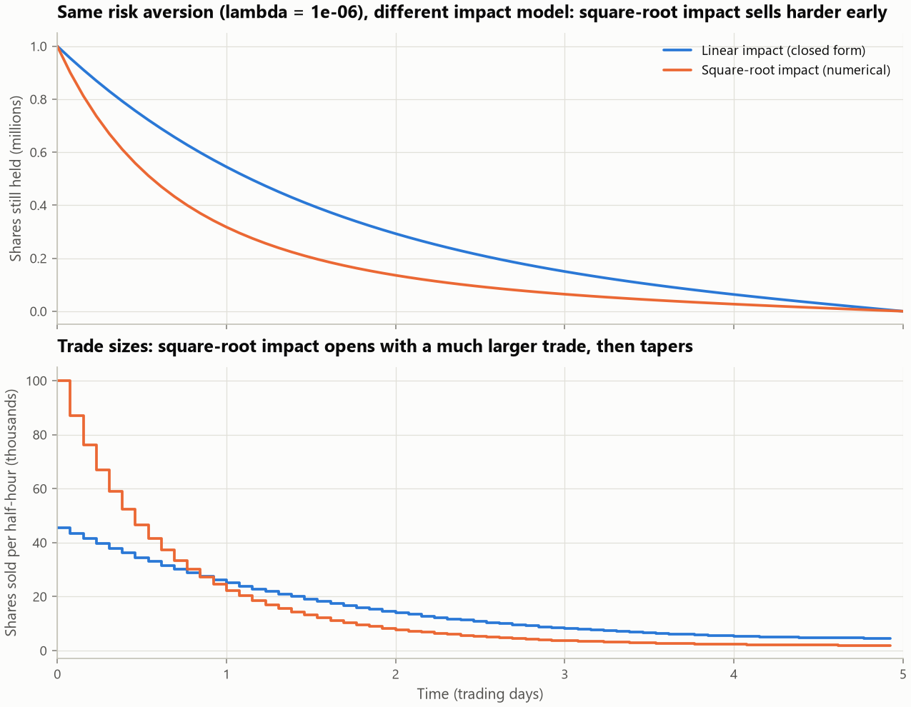

**Limitations / what I'd do next**

- To compare shapes fairly I scaled the square-root model so both models charge the same at TWAP speed. That gives a coefficient of 2.6; I did not check it against empirical estimates, so treat the square-root results as illustrating the shape, not as calibrated numbers.
- Volatility and liquidity are constant, but real markets are busier at the open and close. Next: a volume-weighted (VWAP-style) version with an intraday volume curve.
- The schedule is fixed in advance. It never reacts to the price moving for or against you.
- Mean-variance is one definition of risk. A trader who cares about worst cases would use a different objective.

---

## Case studies

- **[NVIDIA, November 2026](case_studies/nvda_2026/README.md):** how much of NVDA's fall after its board announced an investigation into its CEO was the news, and how much was the market, the chip sector, or an earlier slide? An event study with a placebo test and peer check, plus all four models above applied to the event. Main result: a day-0 abnormal return of **−8.5% (t = −5.0)** and **−13.5% over three days**; only 0.2% of 1,000 random dates were lower. Research only, not investment advice.

## Project layout

```
src/qml/
  common/          data download + cache, shared plot style, performance metrics
  rmt/             Marchenko-Pastur density, eigenvalue clipping, min-variance portfolios
  market_making/   Avellaneda-Stoikov simulator and quoting strategies
  pairs/           Kalman filter, rolling OLS, z-score backtester
  execution/       Almgren-Chriss trajectories, frontier, Monte Carlo
  events/          reusable event-study code (abnormal returns, CARs, placebo test)
experiments/       one runnable script per model
case_studies/      applied studies (nvda_2026/: event study + the four models on NVDA)
tests/             unit tests, all on synthetic data (no network)
results/           figures and tables produced by the experiments
docs/              a plain-English explanation of each model
```

## Learn the models

Each guide explains the problem, every symbol in the equations, how the code is organized, and five interview-style questions:

- [Marchenko-Pastur explained](docs/rmt_EXPLAINED.md)
- [Avellaneda-Stoikov explained](docs/market_making_EXPLAINED.md)
- [Kalman pairs trading explained](docs/pairs_EXPLAINED.md)
- [Almgren-Chriss explained](docs/execution_EXPLAINED.md)

## References

- V. A. Marchenko and L. A. Pastur (1967). "Distribution of eigenvalues for some sets of random matrices." *Mathematics of the USSR-Sbornik*, 1(4).
- L. Laloux, P. Cizeau, J.-P. Bouchaud and M. Potters (1999). "Noise dressing of financial correlation matrices." *Physical Review Letters*, 83(7).
- M. Avellaneda and S. Stoikov (2008). "High-frequency trading in a limit order book." *Quantitative Finance*, 8(3).
- R. Almgren and N. Chriss (2000). "Optimal execution of portfolio transactions." *Journal of Risk*, 3(2).
- E. P. Chan (2013). *Algorithmic Trading: Winning Strategies and Their Rationale*. Wiley. (Kalman filter pairs trading chapter.)

## Disclaimer

This is a research and learning project. Nothing here is investment advice, and none of the code places real orders.

## License

[MIT](LICENSE)
