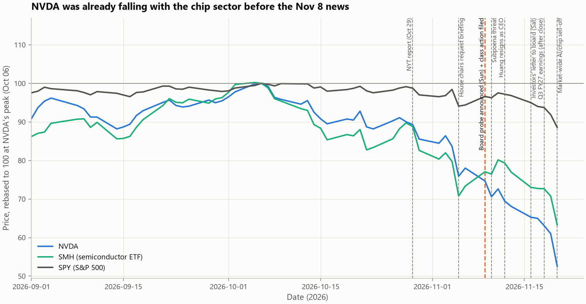
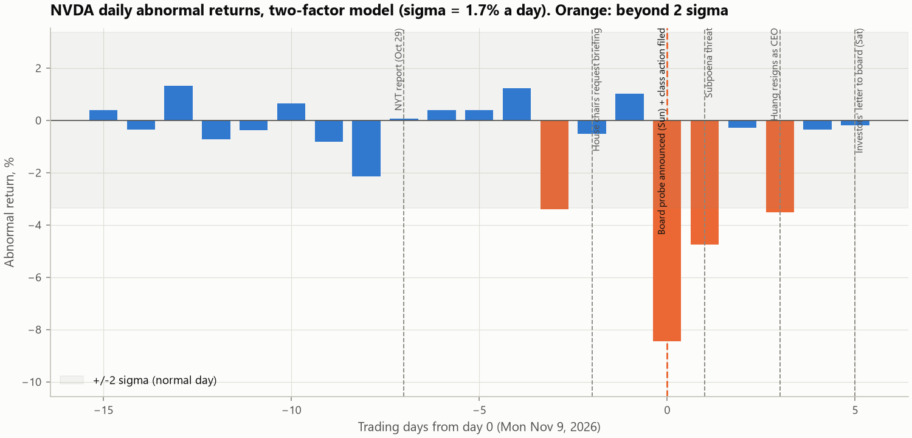
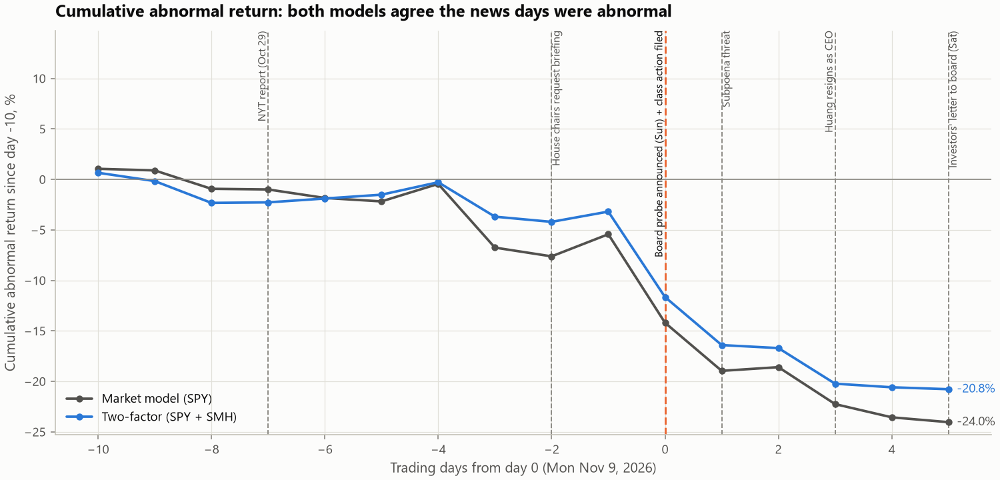
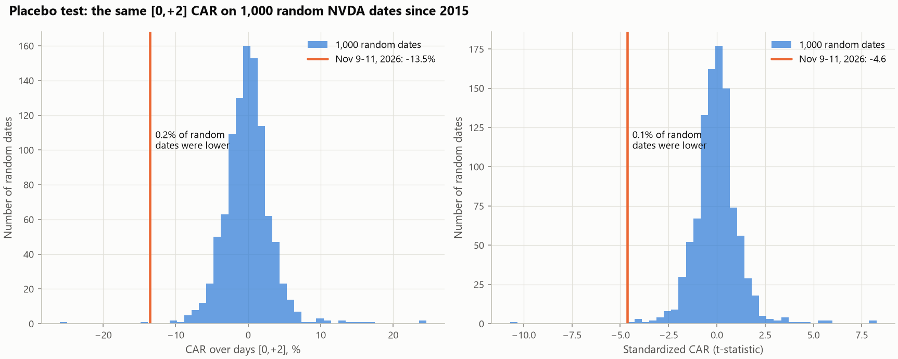
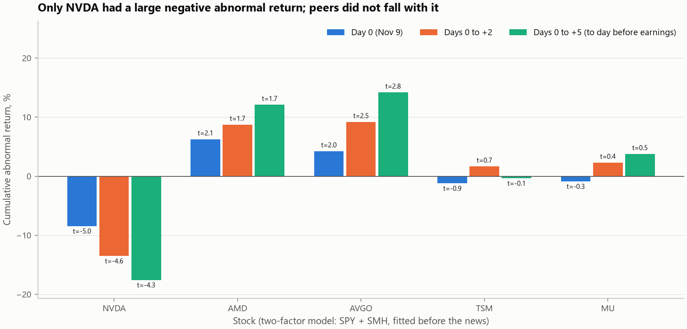
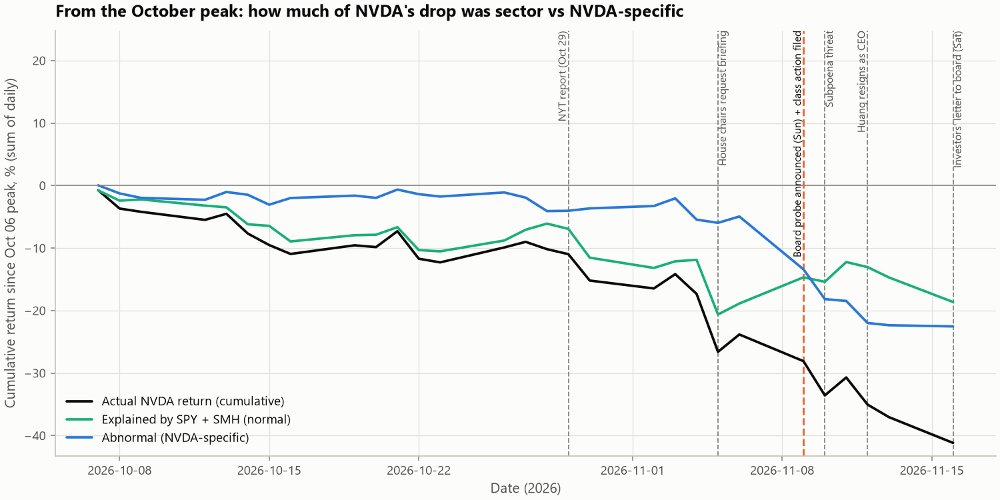
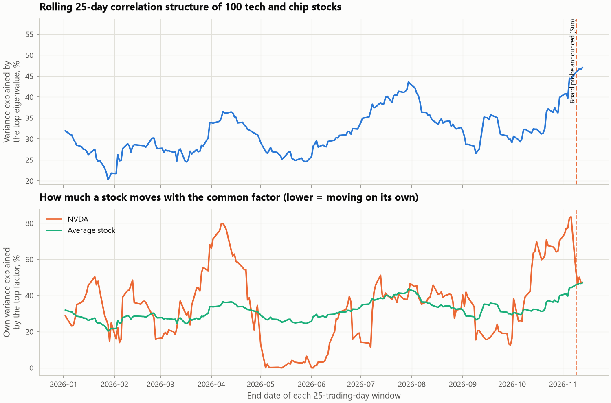
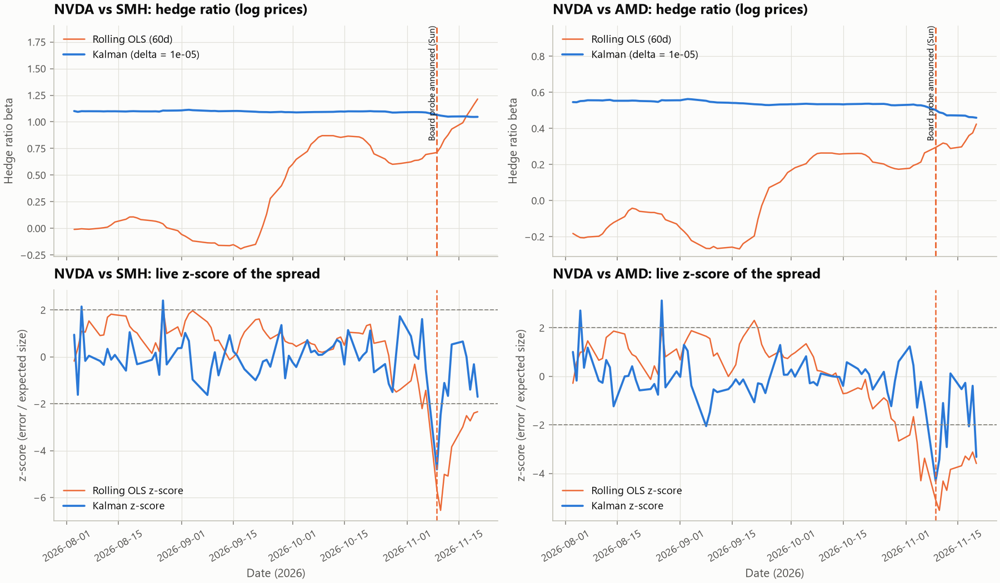
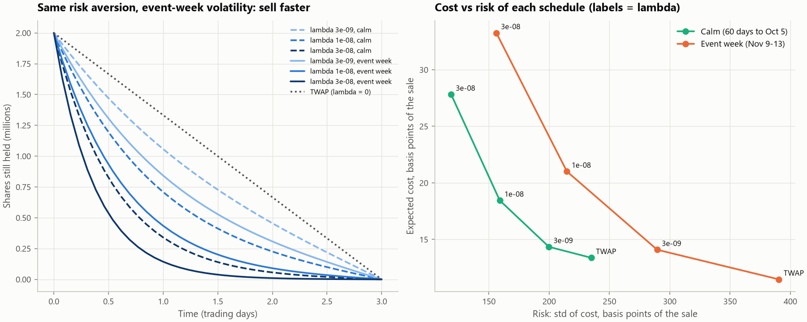
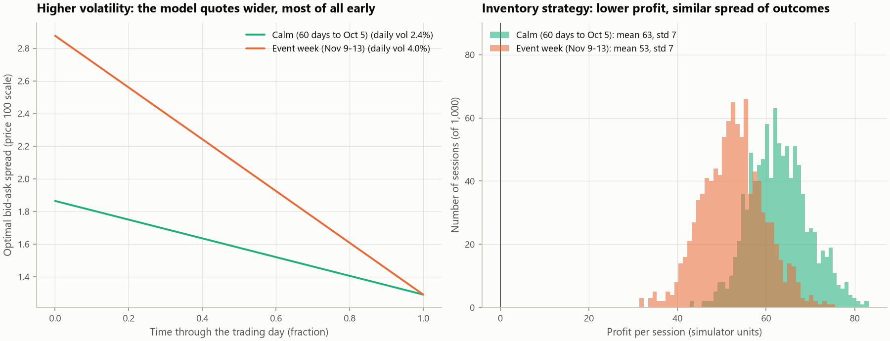

# Case study: NVIDIA, November 2026

How much of NVIDIA's fall after its board announced an investigation into its CEO was caused by that news, and how much was the market, the chip sector, or a slide that had already started?

> **Not investment advice.** This is a research exercise in measuring the price impact of news. It is not a recommendation or a signal to buy, sell or hold NVDA or any other security.

## TL;DR

- **The news moved the stock, and the effect is very unlikely to be chance.** On Monday, Nov 9 (the first trading day after the Sunday announcement), NVDA fell 4.3% while its sector ETF rose 5.1%. Its **abnormal return was −8.5% (t = −5.0)**, and **−13.5% over Nov 9–11 (t = −4.6)**. Only 0.2% of 1,000 random dates in NVDA's history had a lower three-day abnormal return.
- **The news itself was NVDA-only, but about half the slide was sector-wide.** Peers did not fall with NVDA during the news week: AVGO and AMD had *positive* abnormal returns. But from NVDA's Oct 6 peak to Nov 16, **45% of the fall is explained by the market and the chip sector**, 12% by NVDA-specific moves before the news, and **43% by the news window**.
- **Model insight:** before the news, the tech/chip common factor explained 84% of NVDA's daily variance. In the 25 days to Nov 13 that dropped to 47%, the same as an average stock. NVDA stopped moving with its sector, and a Kalman filter flagged the break as a 4.8σ surprise on day 0.

## What happened

Descriptions below only repeat what the linked sources report.

On Oct 29, 2026, the New York Times reported that U.S. officials had been investigating Alice Huang, an executive at Megaspeed (a Singapore-based buyer of Nvidia chips), and described a close relationship between her and Nvidia CEO Jensen Huang ([TechCrunch timeline](https://techcrunch.com/2026/11/12/nvidia-ceo-jensen-huangs-affair-with-alleged-chinese-spy-a-timeline/)). On Sunday, Nov 8, Nvidia's board announced an independent investigation. Reports cited U.S. officials' suspicion that Alice Huang was a Chinese intelligence asset. The board said it had no reason to believe national security or Nvidia secrets were compromised ([Nvidia board statement](https://nvidianews.nvidia.com/news/statement-from-nvidia-board-of-directors), [CNBC](https://www.cnbc.com/2026/11/08/nvidia-jensen-huang-investigation-china-spy.html), [CBS News](https://www.cbsnews.com/news/nvidia-jensen-huang-investigation-china-intelligence/)). A proposed shareholder class action was filed on Nov 9 ([ClassAction.org](https://www.classaction.org/news/nvidia-facing-securities-class-action-over-stock-drop-linked-to-reported-jensen-huang-affair-with-suspected-chinese-spy)), a House committee chair threatened a subpoena on Nov 10 ([Yahoo Finance](https://finance.yahoo.com/markets/stocks/articles/nvidia-erases-2026-gains-republicans-204550552.html)), and on Nov 12 Nvidia announced that Huang had resigned and that CFO Colette Kress would serve as interim CEO ([Nvidia 8-K](https://www.sec.gov/Archives/edgar/data/0001045810/000104581026000082/nvidiaannouncesceotransiti.htm)). The allegations are reports and claims, not findings.

### Verified timeline

Each date was checked against the sources and against the price data. The full list, with descriptions and links, is in [`events.yaml`](events.yaml).

| News date | First trading day priced | Event | Role in the study |
|---|---|---|---|
| Thu Oct 29 | Oct 29–30 | NYT report on Huang and Alice Huang | Separate prior event |
| Thu Nov 5 | Nov 5 | House chairs request a closed-door briefing | Marked (pre-event) |
| **Sun Nov 8** | **Mon Nov 9 (day 0)** | **Board announces independent investigation** | **Main event** |
| Mon Nov 9 | Nov 9 | Shareholder class action filed | Same day as day 0 |
| Tue Nov 10 | Nov 10 (+1) | Subpoena threat | Marked |
| Thu Nov 12 | Nov 12 (+3) | Huang resigns; interim CEO named | Marked |
| Sat Nov 14 | Mon Nov 16 (+5) | Two large shareholders' letter to the board | Marked |
| Tue Nov 17, after close | Wed Nov 18 | Q3 FY2027 earnings | Separate event; all windows stop before it |
| Fri Nov 20 | Nov 20 | Market-wide AI and chip sell-off (Nasdaq −5.3%) | Confound; excluded |



## Method

**Event study.** Fit a "normal return" model on a quiet estimation window (250 trading days, ending 30 trading days before day 0), then measure how far the event days deviate from it.

$$R_{\text{NVDA},t} = \alpha + \beta_1 R_{\text{SPY},t} + \beta_2 R_{\text{SMH},t} + \varepsilon_t$$

$$AR_t = R_{\text{NVDA},t} - \hat{R}_{\text{NVDA},t}, \qquad CAR_{[a,b]} = \sum_{t=a}^{b} AR_t, \qquad t = \frac{CAR_{[a,b]}}{\hat\sigma_\varepsilon \sqrt{b - a + 1}}$$

Two models: the **market model** (SPY only) and a **two-factor model** (SPY + SMH, the semiconductor ETF), so that a chip-sector move is not blamed on the news.

**Placebo test.** Run the identical calculation (new estimation window and all) on 1,000 random dates from NVDA's history since 2015. Dates within 20 trading days of any event in the timeline are excluded. Then see where the real CAR falls.

The reusable code is in [`src/qml/events/event_study.py`](../../src/qml/events/event_study.py), tested in [`tests/test_event_study.py`](../../tests/test_event_study.py) on synthetic data with a planted −5% shock. The four models in Part 2 reuse the repo's existing tested implementations unchanged.

## Part 1: Event study

### Abnormal returns

| Window | Dates | Market model (SPY) | Two-factor (SPY + SMH) |
|---|---|---|---|
| [0] | Nov 9 | −8.8% (t = −4.8) | **−8.5% (t = −5.0)** |
| [0, +1] | Nov 9–10 | −13.5% (t = −5.3) | −13.2% (t = −5.6) |
| [0, +2] | Nov 9–11 | −13.2% (t = −4.2) | **−13.5% (t = −4.6)** |
| [−5, −1] (leak check) | Nov 2–6 | −3.6% (t = −0.9) | −1.3% (t = −0.3) |
| [+1, +5] (to last day before earnings) | Nov 10–16 | −9.8% (t = −2.4) | −9.1% (t = −2.4) |
| [0, +5] (whole post-news period) | Nov 9–16 | −18.6% (t = −4.2) | **−17.6% (t = −4.3)** |

On Nov 9 the two-factor model expected NVDA to **rise** 4.2%, because SPY rose 2.4% and SMH rose 5.1%. NVDA fell 4.3% instead. The [−5, −1] window shows no sign that the news leaked early.

Day by day (two-factor model, residual σ = 1.7% a day): Nov 9 **−8.5%** (board investigation, class action), Nov 10 **−4.8%** (subpoena threat), Nov 11 −0.3%, Nov 12 **−3.5%** (resignation), Nov 13 −0.4%, Nov 16 −0.2% (investors' letter). The days with large abnormal moves are the days with news.





### Is this just noise? The placebo test

| Statistic | Nov 9–11, 2026 | Placebo average | Placebo 1st percentile | Share of placebo dates lower |
|---|---|---|---|---|
| CAR [0, +2] | −13.5% | −0.1% | −7.7% | **0.2%** |
| Standardized CAR (t) | −4.6 | 0.0 | −2.8 | **0.1%** |

The standardized version matters because NVDA's volatility has varied a lot since 2015: a −13% move means less for a wild stock than for a calm one.



### Was it sector-wide? The peer check

| Stock | CAR [0] | CAR [0, +2] | CAR [0, +5] |
|---|---|---|---|
| **NVDA** | **−8.5% (t = −5.0)** | **−13.5% (t = −4.6)** | **−17.6% (t = −4.3)** |
| AMD | +6.3% (t = 2.1) | +8.7% (t = 1.7) | +12.1% (t = 1.7) |
| AVGO | +4.2% (t = 2.0) | +9.2% (t = 2.5) | +14.2% (t = 2.8) |
| TSM | −1.2% (t = −0.9) | +1.7% (t = 0.7) | −0.4% (t = −0.1) |
| MU | −0.9% (t = −0.3) | +2.3% (t = 0.4) | +3.8% (t = 0.5) |

No peer fell with NVDA. AVGO and AMD rose by more than their models predicted. That fits investors moving from NVDA to other AI-chip names, though this study cannot prove why they rose.



**Volume.** NVDA traded 3.9× its 60-day average volume on Nov 9 and **6.3×** on Nov 12, the day the resignation was announced.

### The slide that had already started

NVDA peaked on Oct 6, not just before the news. Splitting its fall from that peak to Nov 16, the last day before earnings, with the two-factor model:

| Part of the move (sum of daily returns, Oct 7 to Nov 16) | Return | Share of the fall |
|---|---|---|
| Explained by SPY + SMH (market and chip sector) | −18.6% | **45%** |
| NVDA-specific, before day 0 (Oct 7 to Nov 6) | −5.0% | 12% |
| NVDA-specific, day 0 onward (the event-window CAR, Nov 9–16) | −17.6% | **43%** |
| **Total** (−34.7% compounded) | **−41.2%** | 100% |

The Oct 29 NYT report itself produced no measurable reaction: CAR [0, +1] = +0.5% (t = 0.2).



### Earnings, as a separate event

Earnings came out after the close on Nov 17, so the first trading day that reflects them is Nov 18, analysed here with the same estimation window. On Nov 18 NVDA's abnormal return was **−2.5% (t = −1.5)**: not significant, despite revenue above analysts' estimates ([Nvidia release](https://nvidianews.nvidia.com/news/nvidia-announces-financial-results-for-third-quarter-fiscal-2027), [CNBC](https://www.cnbc.com/2026/11/18/nvidia-stock-earnings.html)). Longer earnings windows include the market-wide sell-off of Nov 20, so they are not interpreted ([`nvda_earnings_car.md`](results/nvda_earnings_car.md)).

## Part 2: The four models applied to NVDA

### 1. Marchenko-Pastur: did the market's structure change?

The data are daily returns for 100 large US tech and semiconductor stocks.

| Window | Top eigenvalue's share of variance | NVDA's variance explained by the top factor |
|---|---|---|
| Calm: 126 days to Oct 5 (q = 0.79; 27 eigenvalues above λ₊ = 0.71) | 27.9% | 20.5% |
| Calm: average 29-day window (same length as below) | 32.3% | 24.5% |
| Slide + news: Oct 6 to Nov 13 (29 days) | **45.0%** | **47.8%** |



**Takeaway.** The October sell-off was a sector-wide shock: the common factor's share of total variance rose from about 32% to 45%, and in the 25 days before Nov 9 NVDA moved almost entirely with it (84% of its own variance). Then the news broke that link. By Nov 13, the common factor explained 47% of NVDA's variance, the same as an average stock. The 29-day window has fewer days than stocks (q = 3.4), so the Marchenko-Pastur noise band does not exist there. That is why the comparison uses calm windows of the same length.

### 2. Kalman filter: did NVDA decouple from its sector?

These are hedge ratios on log prices. The Kalman δ and noise R were chosen by maximum likelihood on data ending Sep 25, 2026.

| Pair | Method | z-score on Nov 9 | Days with \|z\| > 2, Nov 9–13 | β change, Nov 6 → Nov 13 |
|---|---|---|---|---|
| NVDA vs SMH | Kalman (δ = 1e-5) | −4.8 | 2 | −0.04 |
| NVDA vs SMH | Rolling OLS (60 days) | −5.7 | 5 | +0.24 |
| NVDA vs AMD | Kalman (δ = 1e-5) | −4.3 | 3 | −0.05 |
| NVDA vs AMD | Rolling OLS (60 days) | −5.1 | 5 | +0.02 |



**Takeaway.** Both methods flagged Nov 9 as a 4–6σ break between NVDA and its sector. The Kalman filter treated it as a one-off jump in the gap between the two prices rather than a change in the hedge ratio, absorbed it, and was back inside ±2σ within two to three days. The rolling regression stayed alarmed all week, and its β drifted for reasons unrelated to the news (old days leaving the window). For a trader, the filter answers "has the relationship changed?" more cleanly.

### 3. Almgren-Chriss: what did it cost to sell a big block?

The scenario: a fund sells 2 million NVDA shares over 3 days, in 39 half-hour slices.

**Assumptions.** Volatility and volume are measured from the data. Impact follows a square-root rule of thumb: per-share cost ≈ Y·σ·√(v/V), with Y = 1, translated into the model's linear form at the constant-speed (TWAP) rate. Half of that impact is permanent, and the spread is 1 cent. Y, the permanent share and the spread are assumptions, not measurements; the parameters are in [`almgren_chriss_params.md`](results/almgren_chriss_params.md).

| | Calm (60 days to Oct 5) | Event week (Nov 9–13) |
|---|---|---|
| Daily volatility | 2.4% | 4.0% |
| Average daily volume | 122M shares | 469M shares |
| Expected cost, selling at constant speed | 13.4 bps | 11.5 bps |
| Risk (std of cost) at constant speed | 235 bps | 391 bps |
| Urgency κ at the same λ | 1.0 / day | 1.5 / day (**×1.49**) |
| Share sold on day 1 (λ = 1e-8) | 65% | 78% |



**Takeaway.** Volume roughly quadrupled during the news week, which kept expected impact cost about flat even though volatility rose 66%. What did change is risk: waiting became much more dangerous, so a trader with the same risk aversion should sell faster. The model raises urgency by about 1.5×, and the trader finishes 78% instead of 65% on the first day.

### 4. Avellaneda-Stoikov: what happened to a market maker?

The simulator works in its own units, so NVDA was rescaled to a $100 price: σ = daily volatility in %. The fill parameters k and A use the paper's values, because no NVDA order-book data was used. Each case has 1,000 simulated sessions.

| | Calm (σ = 2.4) | Event week (σ = 4.0) |
|---|---|---|
| Average quoted spread | 1.58 | 2.09 (**+32%**) |
| Spread at the open | 1.86 | 2.88 |
| Inventory strategy: mean profit (std) | 63.0 (6.7) | 52.7 (7.0) |
| Naive symmetric strategy: std of profit | 14.8 | 19.4 |



**Takeaway.** A market maker's inventory risk grows with the *square* of volatility, so when news raises volatility the optimal quotes widen, most of all early in the session when there is more time for the price to move. The inventory-aware strategy keeps its risk about the same by quoting wider and earning about 16% less. A naive maker who does not adjust takes 31% more profit variability. Real market makers widen even more than this model says, because news days bring traders who may know more than they do (adverse selection), which the model leaves out.

## Robustness

The headline result barely moves when the estimation window or the sector benchmark changes. Because NVDA is about a fifth of SMH ([20.6% on Oct 24, 2026](https://stockanalysis.com/etf/SMH/holdings/)), SMH's Nov 9 gain already contains NVDA's own fall. "SMH without NVDA" removes that share, which makes the benchmark cleaner.

| Estimation window | Model | CAR [0] | CAR [0, +2] | CAR [0, +5] |
|---|---|---|---|---|
| 250 days, gap 30 (baseline) | Two-factor (SPY + SMH) | −8.5% (t −5.0) | −13.5% (t −4.6) | −17.6% (t −4.3) |
| 250 days, gap 30 | SMH without NVDA (weight 15% / 20% / 25%) | −8.9% to −9.0% | −13.7% to −13.9% | −18.7% to −18.9% |
| 120 days, gap 30 | Two-factor | −8.3% (t −4.4) | −13.1% (t −4.1) | −17.8% (t −3.9) |
| 250 days, gap 60 | Two-factor | −8.4% (t −5.1) | −13.4% (t −4.7) | −17.5% (t −4.3) |
| 500 days, gap 30 | Two-factor | −9.1% (t −5.3) | −15.0% (t −5.0) | −17.6% (t −4.2) |

Across all 14 specifications, the day-0 abnormal return is between −8.3% and −9.6%, and every t-statistic is below −4.4 ([full table](results/nvda_robustness.md)). Removing NVDA from the sector benchmark makes the abnormal return slightly *more* negative, as expected.

## Limitations

- **Daily data.** Each day's close mixes everything that happened that day. Intraday data would separate the news from the rest of the day's trading, but it was not used here.
- **Overlapping news.** The window also contains the class action, the subpoena threat, the resignation and the investors' letter. The study measures their *combined* effect and cannot cleanly attribute it to any one of them. Wider worries about AI valuations and competition were also in the news, which the sector factor captures only partly.
- **One event.** A single event cannot say how markets react to governance news in general. The placebo test only says this move was unusual for NVDA.
- **Window choices.** Results depend on the estimation window and gap. The robustness table shows the dependence is small, but it is not zero.
- **The benchmark contains the stock.** SMH and SPY both hold NVDA. The ex-NVDA version uses a fixed weight, which is an approximation.
- **Earnings and later days.** Earnings windows longer than one day run into the market-wide sell-off of Nov 20, so only the earnings day itself is interpreted.
- **Model assumptions in Part 2.** The impact coefficient, the permanent-impact share, the spread and the market-maker fill parameters are assumptions, not estimates from NVDA data. Those sections show the *direction* and rough size of effects, not precise costs.

## Reproduce it

From the repo root:

```bash
uv sync
uv run python case_studies/nvda_2026/run_all.py
```

The first run downloads daily prices from Yahoo Finance and caches them in `data/cache/`. Figures and tables are written to [`results/`](results).

## Sources

- CNBC, "Nvidia investigates CEO Jensen Huang's relationship with alleged Chinese spy," Nov 8, 2026: https://www.cnbc.com/2026/11/08/nvidia-jensen-huang-investigation-china-spy.html
- NVIDIA, "Statement From NVIDIA Board of Directors," Nov 8, 2026: https://nvidianews.nvidia.com/news/statement-from-nvidia-board-of-directors
- CBS News, "Nvidia investigates CEO Jensen Huang amid allegations he was target of Chinese intelligence effort": https://www.cbsnews.com/news/nvidia-jensen-huang-investigation-china-intelligence/
- TechCrunch, "The unfolding Jensen Huang scandal: a timeline," Nov 13, 2026: https://techcrunch.com/2026/11/12/nvidia-ceo-jensen-huangs-affair-with-alleged-chinese-spy-a-timeline/
- Yahoo Finance, "Nvidia erases 2026 gains as Republicans threaten Jensen Huang with subpoena," Nov 10, 2026: https://finance.yahoo.com/markets/stocks/articles/nvidia-erases-2026-gains-republicans-204550552.html
- Decrypt, same story: https://decrypt.co/382974/nvidia-erases-2026-gains-republicans-threaten-ceo-subpoena
- ClassAction.org, "NVIDIA facing securities class action," Nov 13, 2026: https://www.classaction.org/news/nvidia-facing-securities-class-action-over-stock-drop-linked-to-reported-jensen-huang-affair-with-suspected-chinese-spy
- NVIDIA, Form 8-K and press release on the CEO transition, Nov 12, 2026: https://www.sec.gov/Archives/edgar/data/0001045810/000104581026000082/nvidiaannouncesceotransiti.htm
- CNBC, "Nvidia CEO Jensen Huang resigns: Live updates," Nov 12, 2026: https://www.cnbc.com/2026/11/12/nvidia-jensen-huang-ceo-live-updates.html
- CNBC, "Nvidia board urged to consider 'potential return of Jensen Huang' by two major investors," Nov 14, 2026: https://www.cnbc.com/2026/11/14/nvidia-investors-jensen-huang-return-board-letter.html
- NVIDIA, "NVIDIA Sets Conference Call for Third-Quarter Financial Results": https://investor.nvidia.com/news/press-release-details/2026/NVIDIA-Sets-Conference-Call-for-Third-Quarter-Financial-Results/default.aspx
- NVIDIA, "NVIDIA Announces Financial Results for Third Quarter Fiscal 2027," Nov 17, 2026: https://nvidianews.nvidia.com/news/nvidia-announces-financial-results-for-third-quarter-fiscal-2027
- CNBC, "Nvidia sinks after earnings," Nov 18, 2026: https://www.cnbc.com/2026/11/18/nvidia-stock-earnings.html
- UPI, "Dow, S&P 500 enter correction as Nasdaq plunges in AI stock sell-off," Nov 20, 2026: https://www.upi.com/Top_News/US/2026/11/20/stocks-dow-jones-nasdaq-correction-territory/1061795214998/
- Yahoo Finance, "Stock Market Midday, Nov. 20": https://finance.yahoo.com/markets/stocks/articles/stock-market-midday-nov-20-172002057.html
- Stock Analysis, SMH holdings (NVDA weight): https://stockanalysis.com/etf/SMH/holdings/
- Methods: MacKinlay, A. C. (1997), "Event Studies in Economics and Finance," *Journal of Economic Literature*, 35(1).
